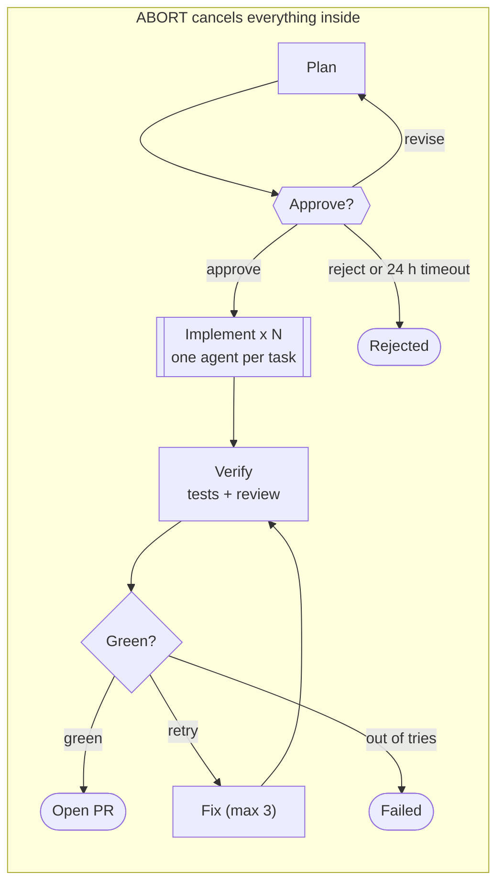
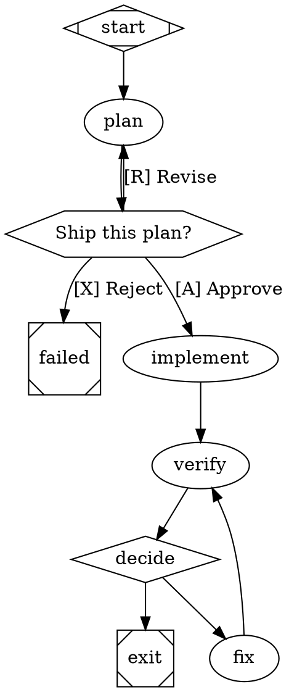

# Workflow Languages

A comparison of human-readable workflow languages for a Temporal-backed agent pipeline runner, as of 2026-10-17. It implements one agent pipeline in Serverless Workflow YAML, a Pkl layer over it, and XState, then compares five more: Amazon States Language, Attractor DOT, BPMN, Temporal workflow-as-code, and WDL as a counterexample. The outcome feeds [marche](../docs/marche.md).

None of the examples have been executed. They were written from knowledge of each spec, not against a validator, so expect small syntax drift, especially in Serverless Workflow's `listen.until`, XState's wildcard actor events, and Attractor's edge conditions. The pattern-coverage verdicts are judged against the revised Workflow Patterns catalogue.

## Summary

Use Serverless Workflow 1.0 as the data model, write it in Pkl rather than YAML, and borrow ideas from Amazon States Language and statecharts. Of the languages here, it fits a Temporal-backed agent runner with the fewest gaps.

- **Serverless Workflow:** covers most patterns and maps directly onto Temporal. Its weak spots are dynamic parallel fan-out and verbose jq expressions.
- **Pkl over Serverless Workflow:** keeps the standard and adds types, reusable helpers (an `agent()` step), templates that repos extend, and checks before anything runs. Nothing like this exists yet; the Pkl schema package has to be written.
- **XState:** models loops, gates and cancellation best, because leaving a state cancels its running work automatically. But it is code-first and not durable on its own.
- **Amazon States Language:** the tightest spec with the right building blocks, including a dynamic `Map` and task tokens for approval. Worth copying even if never run.

## The reference scenario

Every example implements the same feature pipeline, so the languages can be compared line for line. Agent steps run `claude -p` (or any coding agent) in a git worktree and return a commit SHA, never file contents.

1. **Plan:** an agent writes `plan.md` and returns a list of tasks.
2. **Approve:** a human picks approve, revise or reject. Revise loops back to Plan. No answer in 24 hours counts as reject.
3. **Implement:** one agent per task, all in parallel, each in its own worktree. The number of tasks is known only at run time. If one task fails hard, cancel the others.
4. **Verify:** run tests and an AI review in parallel, then wait for both.
5. **Decide:** both green means open a PR. Otherwise, if under 3 fix attempts, run a fix agent and go back to Verify. Otherwise fail.
6. **Abort:** an `abort` signal at any point cancels the whole run.



The revise and fix loops, the run-time fan-out and the abort boundary are where the languages differ most.

| Pattern | WCP | Where it appears |
| --- | --- | --- |
| Sequence | 1 | Plan, then Approve, then Implement |
| Parallel split | 2 | Verify starts tests and review together |
| Synchronization | 3 | Decide waits for both checks |
| Exclusive choice | 4 | Decide: PR, fix or fail |
| Arbitrary cycles | 10 | Revise jumps back to Plan |
| Multiple instances, run-time count | 14 | One implement agent per task in the plan |
| Deferred choice | 16 | Approve: the first of approve, revise, reject or timeout wins |
| Cancel case | 20 | Abort signal |
| Structured loop | 21 | Verify, fix, Verify, at most 3 times |
| Cancel region | 25 | A hard failure cancels sibling implement agents |

Pattern numbers follow Russell, ter Hofstede, van der Aalst and Mulyar, [Workflow Control-Flow Patterns: A Revised View](http://www.workflowpatterns.com/documentation/documents/BPM-06-22.pdf) (2006).

## Serverless Workflow 1.0 (YAML)

Serverless Workflow handles 7 of the 10 patterns natively. Dynamic fan-out needs a workaround, cancel region has no support, and cancel case is left to the runtime. A workflow is a `do` list of named tasks. A `then:` can jump to any task by name, which is how loops and revise cycles work. Expressions are jq inside `${ }`. The CNCF [specification](https://github.com/serverlessworkflow/specification) defines the format.

```yaml
document:
  dsl: '1.0.0'
  namespace: factory
  name: feature-pipeline
  version: '0.1.0'

use:
  functions:
    agent:                                # reusable step: run a coding agent, get a commit SHA back
      run:
        shell:
          command: factory-agent
          arguments:
            prompt: ${ .prompt }
            worktree: ${ .worktree }

do:
  - plan:                                 # WCP-1 sequence
      call: agent
      with:
        prompt: ${ "Write plan.md for: " + $workflow.input.goal }
        worktree: plan
      export:
        as: ${ $context + { plan: ., attempts: 0 } }

  - awaitApproval:                        # WCP-16 deferred choice: first event or timeout wins
      try:
        - listen:
            listen:
              to:
                any:
                  - with: { type: factory.approval.approve }
                  - with: { type: factory.approval.revise }
                  - with: { type: factory.approval.reject }
            timeout:
              after: { hours: 24 }
            output:
              as: ${ { decision: .[0].type } }
      catch:
        errors:
          with:
            type: https://serverlessworkflow.io/spec/1.0.0/errors/timeout
        do:
          - timedOut:
              set: { decision: factory.approval.reject }

  - route:                                # WCP-4 exclusive choice
      switch:
        - approve:
            when: ${ .decision == "factory.approval.approve" }
            then: implement
        - revise:                         # WCP-10 arbitrary cycle back to plan
            when: ${ .decision == "factory.approval.revise" }
            then: plan
        - default:
            then: rejected

  - rejected:
      raise:
        error: { type: https://factory.dev/errors/rejected, status: 400 }

  - implement:                            # WCP-14 workaround: no parallel for-each in 1.0
      do:
        - spawn:
            for:
              each: task
              in: ${ $context.plan.tasks }
            do:
              - start:
                  run:
                    workflow:
                      namespace: factory
                      name: implement-task
                      version: '0.1.0'
                      input: ${ { task: $task, parent: $workflow.id } }
                    await: false          # fire and forget, so children run in parallel
        - collect:
            listen:
              to:
                any:
                  - with: { type: factory.task.done }
                  - with: { type: factory.task.failed }
                until: ${ length == ($context.plan.tasks | length) }

  - verify:                               # WCP-2 split + WCP-3 synchronization
      fork:
        compete: false
        branches:
          - tests:
              run:
                shell: { command: mise run test }
          - review:
              call: agent
              with: { prompt: Review the diff against plan.md, worktree: main }
      output:
        as: ${ { testsOk: (.[0].code == 0), reviewOk: .[1].approved } }

  - decide:                               # WCP-21 structured loop, at most 3 tries
      switch:
        - green:
            when: ${ .testsOk and .reviewOk }
            then: openPr
        - retry:
            when: ${ $context.attempts < 3 }
            then: fix
        - default:
            then: giveUp

  - fix:
      call: agent
      with: { prompt: Fix failing tests and review findings, worktree: main }
      export:
        as: ${ $context + { attempts: ($context.attempts + 1) } }
      then: verify

  - giveUp:
      raise:
        error: { type: https://factory.dev/errors/max-attempts, status: 500 }

  - openPr:
      run:
        shell: { command: gh pr create --fill }
      then: end
```

**What works well:**

- **Deferred choice is native:** `listen` with `any`, a task `timeout` and `try`/`catch` give "first of three events, or a default after 24 hours."
- **Loops are plain jumps:** `then: plan` and `then: verify` express both cycles without special loop syntax.
- **It maps directly onto Temporal:** `listen` becomes a signal wait, `wait` a durable timer, `run` an activity, and `run: workflow` a child workflow. Zigflow already does this.

**Gaps:**

- **No dynamic parallel fan-out (WCP-14):** `fork` branches are fixed at design time and `for` runs in sequence. The workaround above starts child workflows with `await: false` and counts completion events, which is clumsy. A runtime extension like `for: { parallel: true }` would fix it.
- **No cancel region (WCP-25):** children started without waiting can't be canceled from the spec. Each child would have to listen for a `cancel` event.
- **Cancel case (WCP-20) belongs to the runtime:** version 1.0 dropped the workflow-level event handlers of 0.8, so abort is a lifecycle call such as `temporal workflow cancel`, not something written in the workflow.
- **jq expressions are noisy:** `$context + { ... }` and `export.as` are where most authoring mistakes will happen.

## Pkl over Serverless Workflow (hypothetical)

Pkl keeps the standard and fixes the authoring problems: typos become evaluation errors, repeated shapes become functions, and the two gaps above can be hidden behind higher-level tasks that expand to valid Serverless Workflow. No Pkl package for the spec exists today; this section sketches the one to write. [Pkl](https://pkl-lang.org/) is Apple's typed configuration language. It renders YAML or JSON.

Two details make Pkl a good fit. Pkl interpolates with `\(expr)`, so jq's `${ }` passes through untouched. And Pkl has a built-in `Duration` type: `24.h` is checked, then rendered as `{ hours: 24 }`.

### The schema module (sketch)

```pkl
module sw.Workflow

import "tasks.pkl" as t

namespace: String
name: String(matches(Regex(#"[a-z][a-z0-9-]*"#)))
version: String

local flow = Set("continue", "exit", "end")

// Ordered: Pkl mappings keep declaration order, which becomes the do-list order.
// Constraint: every `then` must name a real task or a flow directive.
tasks: Mapping<String, t.Task>(
  this.values.every((task) -> task.then == null || flow.contains(task.then) || this.keys.contains(task.then))
)

output {
  renderer = new YamlRenderer {
    converters {
      [Duration] = (d) -> Map(Map("h", "hours", "min", "minutes", "s", "seconds", "d", "days")[d.unit], d.value)
      // plus: a converter per task class that emits the 1.0 shape, and
      // `tasks` rendered as a list of single-key maps under `do:`
    }
  }
}
```

```pkl
// tasks.pkl: the core 1.0 tasks, plus two macros that expand to them
abstract class Task { then: String?; timeout: Duration? }
class Call extends Task { call: String; with: Mapping<String, Any>; export: String? }
class Shell extends Task { command: String }
class Switch extends Task { cases: Listing<Case>; default: String }
class Case { when: String; then: String }
class Fork extends Task { branches: Mapping<String, Task>; compete: Boolean = false }
class Raise extends Task { type: String; status: Int(isBetween(400, 599)) }

// Macro: renders as listen(any) + timeout + try/catch, as in the YAML above.
class Approval extends Task { events: Listing<String>(!isEmpty); onTimeout: String }

// Macro: renders as the spawn + collect workaround, or as a runtime extension
// when the target runner supports one.
class ParallelForEach extends Task {
  each: String
  in: String
  workflow: String
  cancelOnFailure: Boolean = true
}
```

### The pipeline

```pkl
amends "package://pkg.example.dev/sw@0.1.0#/Workflow.pkl"   // hypothetical package
import "package://pkg.example.dev/sw@0.1.0#/tasks.pkl" as t

local maxAttempts = 3

local function agent(prompt: String, worktree: String): t.Call = new {
  call = "agent"
  with { ["prompt"] = prompt; ["worktree"] = worktree }
}

namespace = "factory"
name = "feature-pipeline"
version = "0.1.0"

tasks {
  ["plan"] = (agent(#"${ "Write plan.md for: " + $workflow.input.goal }"#, "plan")) {
    export = "${ $context + { plan: ., attempts: 0 } }"
  }
  ["awaitApproval"] = new t.Approval {          // WCP-16
    events { "approve" "revise" "reject" }
    timeout = 24.h
    onTimeout = "reject"
  }
  ["route"] = new t.Switch {                     // WCP-4, WCP-10
    cases {
      new { when = #"${ .decision == "approve" }"#; then = "implement" }
      new { when = #"${ .decision == "revise" }"#;  then = "plan" }
    }
    default = "rejected"
  }
  ["rejected"] = new t.Raise { type = "https://factory.dev/errors/rejected"; status = 400 }
  ["implement"] = new t.ParallelForEach {        // WCP-14, WCP-25
    each = "task"
    in = "${ $context.plan.tasks }"
    workflow = "implement-task"
  }
  ["verify"] = new t.Fork {                      // WCP-2, WCP-3
    branches {
      ["tests"] = new t.Shell { command = "mise run test" }
      ["review"] = agent("Review the diff against plan.md", "main")
    }
  }
  ["decide"] = new t.Switch {                    // WCP-21
    cases {
      new { when = "${ .testsOk and .reviewOk }"; then = "openPr" }
      new { when = "${ $context.attempts < \(maxAttempts) }"; then = "fix" }
    }
    default = "giveUp"
  }
  ["fix"] = (agent("Fix failing tests and review findings", "main")) {
    export = "${ $context + { attempts: ($context.attempts + 1) } }"
    then = "verify"
  }
  ["giveUp"] = new t.Raise { type = "https://factory.dev/errors/max-attempts"; status = 500 }
  ["openPr"] = new t.Shell { command = "gh pr create --fill"; then = "end" }
}
```

`pkl eval -f yaml feature.pkl` renders standard Serverless Workflow that Zigflow or another runner can execute. Mistype `then = "verfy"` and evaluation fails on the `tasks` constraint before anything runs.

**What Pkl buys:**

- **Checks before anything runs:** bad jump targets, missing fields, out-of-range status codes and malformed durations all fail at `pkl eval`. A YAML schema catches field shapes but not cross-references.
- **Abstraction without forking the standard:** `agent()`, `Approval` and `ParallelForEach` are author-side macros. What the runtime receives is still plain Serverless Workflow.
- **Reuse by extension:** see [Reuse and extension](#reuse-and-extension).

**What it costs:**

- **The schema package and its renderers:** roughly one class per 1.0 task type, maintained by us.
- **jq stays inside strings:** Pkl can't check `${ .testsOk and .reviewOk }`, so expression errors still appear only at run time.
- **Pkl in Rust is thin:** official bindings are Java/Kotlin, Swift and Go. A Rust runner consumes the rendered JSON, not Pkl directly.

## Reuse and extension

Pkl is much better at extension: taking a shared pipeline and changing parts of it. Serverless Workflow is better at composition: calling a shared workflow as a black box with its own version. The two layers fit together.

### Reuse in Serverless Workflow YAML

1. **Subworkflows:** `run: workflow` by namespace, name and version. A shared `implement-task` or `open-pr` lives in a registry and each pipeline pins a version. On Temporal each one becomes a child workflow with its own history and retries. It's a black box: nothing inside it can be changed.
2. **`use.functions` and catalogs:** define a step like `agent` once and call it by name. Version 1.0 also appears to add shared function catalogs (`call: name:version@catalog`); check the exact syntax.
3. **`use.extensions`:** insert tasks `before` or `after` every task of a given type, optionally filtered with `when`. Good for cross-cutting work such as an audit event around every agent call. It can't target one specific step.
4. **Workflow `input`:** run-time parameters like `$workflow.input.maxAttempts // 3`, with defaults buried in jq.

What's missing is changing one step of a shared pipeline: swapping the test command, adding a security check to Verify, or dropping the approval gate. YAML anchors only work within one file, so in practice customization means copying the file, and copies drift.

### Reuse in Pkl

| Need | How Pkl does it |
| --- | --- |
| Import a shared pipeline | `amends "package://…/factory-pipelines@1.2.0#/feature.pkl"`, with versioned, checksummed packages pinned in `PklProject` |
| Change settings | Override `maxAttempts = 5`. References are resolved after overrides (late binding), so the base's `decide` step picks up the new value |
| Change one step | `tasks { ["openPr"] { command = "gh pr create --draft" } }` amends that entry and keeps the rest |
| Add a step | Through extension points the base declares (below); plain appends land at the end |
| Remove a step | `tasks = super.tasks.toMap().remove("awaitApproval").toMapping()`, and the jump-target check flags any `then:` that pointed at it |
| Validate the result | `pkl eval` type-checks the merged workflow, base plus overrides, before anything runs |

A shared base with extension points:

```pkl
// package factory-pipelines@1.2.0: feature.pkl
open module factory.pipelines.Feature
extends "package://pkg.example.dev/sw@0.1.0#/Workflow.pkl"
import "package://pkg.example.dev/sw@0.1.0#/tasks.pkl" as t
import "agents.pkl"

// Settings: typed, with defaults
maxAttempts: Int(isBetween(1, 10)) = 3
testCommand: String = "mise run test"
approvalWindow: Duration = 24.h

// Extension point: extra checks run in parallel with tests and review
extraChecks: Mapping<String, t.Task> = new {}

tasks {
  ["plan"] = agents.agent(#"${ "Write plan.md for: " + $workflow.input.goal }"#, "plan")
  ["awaitApproval"] = new t.Approval { events { "approve" "revise" "reject" }; timeout = approvalWindow; onTimeout = "reject" }
  // … route, implement …
  ["verify"] = new t.Fork {
    branches {
      ["tests"] = new t.Shell { command = testCommand }
      ["review"] = agents.agent("Review the diff against plan.md", "main")
      ...extraChecks
    }
  }
  ["decide"] = new t.Switch {
    cases {
      new { when = "${ .allOk }"; then = "openPr" }
      new { when = "${ $context.attempts < \(maxAttempts) }"; then = "fix" }
    }
    default = "giveUp"
  }
  // … fix, giveUp, openPr …
}
```

A repo's customization, 15 lines instead of a 120-line copy:

```pkl
// my-service/.factory/feature.pkl
amends "package://pkg.example.dev/factory-pipelines@1.2.0#/feature.pkl"
import "package://pkg.example.dev/factory-pipelines@1.2.0#/agents.pkl"

name = "my-service-feature"
maxAttempts = 5
testCommand = "cargo nextest run && cargo clippy -- -D warnings"
approvalWindow = 4.h

extraChecks {
  ["security"] = agents.agent("Security-review the diff", "main")
}

tasks {
  ["openPr"] { command = "gh pr create --fill --draft" }   // amend one step, keep the rest
}
```

Two traps:

- **Ordering:** the Serverless Workflow `do` list is ordered, and a key added while amending a Pkl mapping goes at the end. A child adding `["lint"]` would land after `openPr`. Fix it with extension points the base declares (`extraChecks`, `beforeImplement`, `afterVerify`) that the renderer splices into place, or by wiring every step with explicit `then:` jumps so order stops mattering.
- **Flattening at author time:** the runner receives one standalone document, so what ran is reproducible. But a new base package version doesn't reach a repo until it re-renders. Add a CI step that runs `pkl eval` and diffs the rendered YAML, so base upgrades are reviewed like code.

### Use both layers

| Kind of reuse | Mechanism | Examples |
| --- | --- | --- |
| A template whose inside you customize | Pkl `amends` and extension points | Feature, bugfix and dependency-bump pipelines |
| A unit called as a black box, versioned on its own | Serverless Workflow `run: workflow` (a Temporal child workflow) | `implement-task`, `open-pr`, `security-review` |
| Something added around every step of a kind | `use.extensions`, emitted by the Pkl base | Audit events around agent calls, cost tracking |

Rule of thumb: if callers need to change a piece's internals, make it a Pkl template. If they should only pass inputs and pin a version, make it a subworkflow. Pkl emits both, so a repo's `feature.pkl` amends a template whose steps call shared subworkflows by version.

## XState v5 (statechart)

XState covers all 10 patterns, and the hard ones most cleanly. Leaving a state stops the work invoked inside it, so cancel region and cancel case come almost free. The tradeoff is that it is TypeScript, not a data format, and not durable by itself. [XState](https://stately.ai/docs/xstate) implements Harel statecharts, which the W3C standardized as [SCXML](https://www.w3.org/TR/scxml/). Every step is a state, and the pipeline is the set of transitions between them.

```ts
import { setup, assign, enqueueActions, fromPromise } from 'xstate';

type Task = { id: string; prompt: string };

export const featurePipeline = setup({
  types: {
    context: {} as { goal: string; tasks: Task[]; done: string[]; attempts: number; testsOk?: boolean; reviewOk?: boolean; workers?: unknown[] },
    input: {} as { goal: string },
    events: {} as { type: 'APPROVE' } | { type: 'REVISE' } | { type: 'REJECT' } | { type: 'ABORT' },
  },
  actors: {
    // `signal` aborts when the owning state is exited: that is the cancellation hook
    agent: fromPromise(async ({ input, signal }: { input: { prompt: string; worktree: string }; signal: AbortSignal }) =>
      runAgent(input, signal)),                                   // -> { sha, tasks?, approved? }
    shell: fromPromise(async ({ input, signal }: { input: { command: string }; signal: AbortSignal }) =>
      runShell(input.command, signal)),                           // -> { code }
  },
  guards: {
    green: ({ context }) => !!context.testsOk && !!context.reviewOk,
    canRetry: ({ context }) => context.attempts < 3,
    allTasksDone: ({ context }) => context.done.length === context.tasks.length,
  },
  delays: { approvalWindow: 24 * 60 * 60 * 1000 },
}).createMachine({
  id: 'featurePipeline',
  context: ({ input }) => ({ goal: input.goal, tasks: [], done: [], attempts: 0 }),
  initial: 'planning',
  on: { ABORT: '.aborted' },                                      // WCP-20 cancel case, from any state

  states: {
    planning: {                                                   // WCP-1
      invoke: {
        src: 'agent',
        input: ({ context }) => ({ prompt: `Write plan.md for: ${context.goal}`, worktree: 'plan' }),
        onDone: { target: 'awaitingApproval', actions: assign({ tasks: ({ event }) => event.output.tasks }) },
        onError: 'failed',
      },
    },

    awaitingApproval: {                                           // WCP-16 deferred choice
      on: { APPROVE: 'implementing', REVISE: 'planning', REJECT: 'rejected' },   // REVISE = WCP-10 cycle
      after: { approvalWindow: 'rejected' },
    },

    implementing: {                                               // WCP-14: one child per task, count from context
      entry: assign({
        done: [],
        workers: ({ context, spawn }) => context.tasks.map((t) =>
          spawn('agent', { id: `task-${t.id}`, input: { prompt: t.prompt, worktree: t.id } })),
      }),
      on: {
        'xstate.done.actor.*': { actions: assign({ done: ({ context, event }) => [...context.done, event.actorId] }) },
        'xstate.error.actor.*': 'failed',                         // WCP-25: one hard failure ends the region
      },
      always: { guard: 'allTasksDone', target: 'verifying' },
      // Spawned children outlive their state, so stop them explicitly on exit.
      exit: enqueueActions(({ context, enqueue }) => context.tasks.forEach((t) => enqueue.stopChild(`task-${t.id}`))),
    },

    verifying: {                                                  // WCP-2 split + WCP-3 synchronization
      type: 'parallel',
      states: {
        tests: {
          initial: 'running',
          states: {
            running: { invoke: { src: 'shell', input: { command: 'mise run test' },
              onDone: { target: 'finished', actions: assign({ testsOk: ({ event }) => event.output.code === 0 }) } } },
            finished: { type: 'final' },
          },
        },
        review: {
          initial: 'running',
          states: {
            running: { invoke: { src: 'agent', input: { prompt: 'Review the diff against plan.md', worktree: 'main' },
              onDone: { target: 'finished', actions: assign({ reviewOk: ({ event }) => event.output.approved }) } } },
            finished: { type: 'final' },
          },
        },
      },
      onDone: 'deciding',                                         // fires when both regions are final
    },

    deciding: {                                                   // WCP-4 choice + WCP-21 loop
      always: [
        { guard: 'green', target: 'openingPr' },
        { guard: 'canRetry', target: 'fixing' },
        { target: 'failed' },
      ],
    },

    fixing: {
      entry: assign({ attempts: ({ context }) => context.attempts + 1 }),
      invoke: { src: 'agent', input: { prompt: 'Fix failing tests and review findings', worktree: 'main' },
        onDone: 'verifying', onError: 'failed' },
    },

    openingPr: {
      invoke: { src: 'shell', input: { command: 'gh pr create --fill' }, onDone: 'done', onError: 'failed' },
    },

    done: { type: 'final' },
    rejected: { type: 'final' },
    aborted: { type: 'final' },
    failed: { type: 'final' },
  },
});
```

**What works well:**

- **Cancellation is part of the model:** an `ABORT` from any state exits the current state, and XState stops every actor invoked there and fires its `AbortSignal`. In Serverless Workflow this is the weakest area.
- **Loops and gates read as a state diagram:** `awaitingApproval` is a state that waits for one of three events or a timer. Stately's visual editor renders the machine and round-trips edits.
- **Dynamic fan-out is ordinary code:** `spawn` takes a list from context, and the wildcard `xstate.done.actor.*` collects results.
- **Typed end to end:** events, context and actor inputs are checked by TypeScript.

**Gaps:**

- **Code, not a format:** the machine config could be JSON if every guard and actor were referenced by name, but inline functions creep in and only a TypeScript runtime can load it.
- **Not durable on its own:** `actor.getPersistedSnapshot()` saves state and context, but an in-flight promise is restarted on restore. For hours-long runs the machine would be hosted inside a Temporal TypeScript workflow, where `setTimeout` becomes a durable timer, actors call activities, and signals become `actor.send`. That should work, but no maintained integration turned up.
- **Spawned children are not state-scoped:** only `invoke` is canceled automatically. Dynamic workers need the explicit `stopChild` on exit shown above.
- **Verbose for simple pipelines:** each parallel branch needs its own running and finished states, about 12 lines where Serverless Workflow uses 3.

## Other languages

Five more, each shown on the part of the scenario where it differs most. Amazon States Language and Temporal workflow-as-code are worth real study. Attractor and BPMN are useful references. WDL shows what a workflow language without loops or waits can't express.

### Amazon States Language (JSON)

[ASL](https://states-language.net/spec.html) is the smallest spec here with the right building blocks. `Map` is a native dynamic fan-out, and when one iteration fails the others stop. `waitForTaskToken` with `TimeoutSeconds` is a durable human gate. Its weaknesses: JSON only, `Resource` fields that assume AWS ARNs, and few open-source runners.

```json
"AwaitApproval": {
  "Type": "Task",
  "Resource": "arn:aws:states:::lambda:invoke.waitForTaskToken",
  "Parameters": { "FunctionName": "notify-approver", "Payload": { "token.$": "$$.Task.Token" } },
  "TimeoutSeconds": 86400,
  "Catch": [{ "ErrorEquals": ["States.Timeout"], "Next": "Rejected" }],
  "Next": "Route"
},
"Route": {
  "Type": "Choice",
  "Choices": [
    { "Variable": "$.decision", "StringEquals": "approve", "Next": "Implement" },
    { "Variable": "$.decision", "StringEquals": "revise",  "Next": "Plan" }
  ],
  "Default": "Rejected"
},
"Implement": {
  "Type": "Map",
  "ItemsPath": "$.plan.tasks",
  "MaxConcurrency": 8,
  "ItemProcessor": {
    "StartAt": "Agent",
    "States": { "Agent": { "Type": "Task", "Resource": "arn:aws:states:::activity:agent", "End": true } }
  },
  "Catch": [{ "ErrorEquals": ["States.ALL"], "Next": "Failed" }],
  "Next": "Verify"
}
```

Worth copying even if never run: `Map` with `MaxConcurrency`, per-state `Retry` and `Catch`, and the task-token gate are the three things Serverless Workflow handles least well.

### Attractor DOT

[Attractor](https://github.com/strongdm/attractor/blob/main/attractor-spec.md) is built for agents. Nodes are prompts, and a node's Graphviz shape sets its type: `hexagon` is a human gate whose choices come from its outgoing edge labels, `diamond` a conditional, `component` a parallel fan-out. It is the only language here that renders as its own diagram. It has no native dynamic fan-out: `component` branches are drawn edges, not a list from the plan. [Fabro](https://github.com/fabro-sh/fabro) (Rust) is the most complete runner, and others exist in Go, TypeScript, Python and Ruby.



The edge-condition syntax is approximate, and the attempt cap would come from the spec's retry attributes.

### BPMN 2.0

[BPMN](https://www.omg.org/spec/BPMN/2.0.2/) covers every pattern in the scenario: event-based gateways for deferred choice, parallel multi-instance tasks for dynamic fan-out, and boundary error events and terminate end events for cancellation. The readable form is the diagram; the XML isn't meant to be written by hand.

```xml
<bpmn:userTask id="approve" name="Approve plan"/>
<bpmn:boundaryEvent id="approvalTimeout" attachedToRef="approve">
  <bpmn:timerEventDefinition><bpmn:timeDuration>PT24H</bpmn:timeDuration></bpmn:timerEventDefinition>
</bpmn:boundaryEvent>
<bpmn:serviceTask id="implement" name="Implement task">
  <bpmn:multiInstanceLoopCharacteristics isSequential="false"/>
</bpmn:serviceTask>
```

Only worth it if non-engineers will read or edit processes as diagrams. Engines include Camunda/Zeebe, Flowable, Operaton and the Python library SpiffWorkflow.

### Temporal workflow-as-code (TypeScript)

Plain code is the baseline every language here competes with. It expresses all 10 patterns in about 30 lines and is durable.

```ts
export async function featurePipeline(goal: string) {
  let decision: 'approve' | 'revise' | 'reject' | undefined;
  setHandler(decideSignal, (d) => { decision = d; });

  let plan;
  do {                                                            // WCP-10 revise cycle
    plan = await agent({ prompt: `Write plan.md for: ${goal}`, worktree: 'plan' });
    decision = undefined;
    const answered = await condition(() => decision !== undefined, '24h');   // WCP-16
    if (!answered || decision === 'reject') throw ApplicationFailure.nonRetryable('rejected');
  } while (decision === 'revise');

  const scope = new CancellationScope();                          // WCP-14 + WCP-25
  await scope.run(() => Promise.all(plan.tasks.map((t) => agent({ prompt: t.prompt, worktree: t.id }))))
    .catch((err) => { scope.cancel(); throw err; });

  for (let attempt = 0; ; attempt++) {                            // WCP-21
    const [tests, review] = await Promise.all([                  // WCP-2 + WCP-3
      shell('mise run test'),
      agent({ prompt: 'Review the diff against plan.md', worktree: 'main' }),
    ]);
    if (tests.code === 0 && review.approved) break;
    if (attempt >= 3) throw ApplicationFailure.nonRetryable('max attempts');
    await agent({ prompt: 'Fix failing tests and review findings', worktree: 'main' });
  }
  return shell('gh pr create --fill');                           // WCP-20: `temporal workflow cancel` cancels the run
}
```

A language is worth adding on top only if it buys something code can't: a diagram, editing by non-programmers, checks before run time, templates that repos extend, or graphs an agent can write safely.

### WDL (counterexample)

[WDL](https://github.com/openwdl/wdl) is the nicest-reading textual workflow standard, and it shows what is lost without loops or waits. `scatter` gives dynamic fan-out, but there is no way to go back to Plan or Verify, wait for a person, or cancel siblings.

```wdl
version 1.1

workflow feature_pipeline {
  input { String goal }
  call plan { input: goal = goal }
  scatter (t in plan.tasks) {
    call implement { input: task = t }
  }
  call verify { input: shas = implement.sha }
  # no loop back to fix, no human gate, no cancellation
}
```

### Also considered

- **[CUE](https://cuelang.org/):** an alternative to Pkl for authoring Serverless Workflow. Stronger at validation, weaker at abstraction, and it can import the spec's JSON Schema directly.
- **[Archon](https://github.com/coleam00/Archon) YAML:** product-specific, with native approval and loop nodes for coding agents, but not a standard.
- **Argo Workflows and Dagu:** YAML DAG runners for CI-style batch work, with suspend steps for approval and limited loops.

## Comparison

BPMN, XState and plain Temporal code express all 10 patterns natively. Among the data formats, Serverless Workflow with a Pkl layer and ASL come closest, and they split on the two hardest patterns: dynamic fan-out and cancel region.

"Runtime" means the runtime provides it, not the language. "Macro" means the Pkl layer expands it into a workaround.

| Pattern | Serverless Workflow | Pkl + SW | XState | ASL | Attractor | BPMN | Temporal code | WDL |
| --- | --- | --- | --- | --- | --- | --- | --- | --- |
| 1 Sequence | yes | yes | yes | yes | yes | yes | yes | yes |
| 2 Parallel split | yes | yes | yes | yes | yes | yes | yes | yes |
| 3 Synchronization | yes | yes | yes | yes | yes | yes | yes | yes |
| 4 Exclusive choice | yes | yes | yes | yes | yes | yes | yes | partial |
| 10 Arbitrary cycles | yes | yes | yes | yes | yes | yes | yes | no |
| 14 Run-time fan-out | workaround | macro | yes | yes | no | yes | yes | yes |
| 16 Deferred choice | yes | yes | yes | partial | yes | yes | yes | no |
| 20 Cancel case | runtime | runtime | yes | runtime | runtime | yes | runtime | runtime |
| 21 Structured loop | yes | yes | yes | yes | yes | yes | yes | no |
| 25 Cancel region | no | macro | yes | yes | unclear | yes | yes | no |

| Language | Format | Writing by hand | Diagram | Checked before run | On Temporal | Maintained by |
| --- | --- | --- | --- | --- | --- | --- |
| Serverless Workflow | YAML or JSON | Good, but noisy jq | Through editor tooling | JSON Schema | Zigflow, or an interpreter workflow | CNCF |
| Pkl + SW | Pkl, rendered to YAML or JSON | Best of the data formats | Same as SW | Types and cross-reference checks | Same as SW | CNCF underneath, layer is ours |
| XState | TypeScript | Good for developers | Stately visual editor | TypeScript compiler | Inside a TS workflow (unproven) | Stately; SCXML at W3C |
| ASL | JSON | Fair | AWS console only | JSON Schema | None maintained | AWS (published spec) |
| Attractor | Graphviz DOT | Good for small graphs | Native | Depends on implementation | No; Fabro keeps Git-backed state | StrongDM (published spec) |
| BPMN | XML | Poor; use a modeler | Native, the main point | Engine validation | No; Camunda and Zeebe are their own engines | OMG, ISO 19510 |
| Temporal code | Go, TS, Python, Java | Developers only | None | Compiler | Native | Temporal |
| WDL | Own syntax | Excellent | Through tooling | Type checker (Sprocket) | No | OpenWDL |

## Recommendation

Build on Serverless Workflow 1.0, author it in Pkl, run it on Temporal, and take two semantics from elsewhere: ASL's `Map` and statechart-style cancellation. That keeps a CNCF standard at the center and closes its two real gaps with a small, explicit extension. [marche](../docs/marche.md) adopts this.

1. **Data model:** Serverless Workflow 1.0 plus one runtime extension, a parallel for-each with `maxConcurrency` and cancel-siblings-on-failure (ASL `Map` semantics). Write the extension up so it could be proposed upstream.
2. **Authoring:** Pkl. Ship `agent()`, `Approval` and `ParallelForEach` as macros, plus a constraint that checks every jump target. Render JSON for the runner.
3. **Runtime:** Zigflow on Temporal to start, with the definition pinned by content hash at start. Replace it with our own interpreter if its task coverage falls short.
4. **Cancellation rule, from statecharts:** leaving a `do`, `fork` or `try` scope cancels everything started inside it. That one rule gives cancel region and cancel case without new syntax.
5. **Diagrams, from Attractor:** generate DOT or Mermaid from each rendered workflow for review, getting Attractor's main advantage without its format.

Reconsider XState if pipelines turn into long-lived interactive sessions with many mid-run events, such as steering or pausing.

## Sources

- [Serverless Workflow specification](https://github.com/serverlessworkflow/specification)
- [Zigflow](https://github.com/zigflow/zigflow)
- [Pkl](https://pkl-lang.org/)
- [XState documentation](https://stately.ai/docs/xstate)
- [SCXML (W3C)](https://www.w3.org/TR/scxml/)
- [Amazon States Language](https://states-language.net/spec.html)
- [Attractor specification](https://github.com/strongdm/attractor/blob/main/attractor-spec.md)
- [Fabro](https://github.com/fabro-sh/fabro)
- [BPMN 2.0.2 (OMG)](https://www.omg.org/spec/BPMN/2.0.2/)
- [WDL](https://github.com/openwdl/wdl)
- [Workflow Control-Flow Patterns: A Revised View](http://www.workflowpatterns.com/documentation/documents/BPM-06-22.pdf)
- [Temporal documentation](https://docs.temporal.io/)
